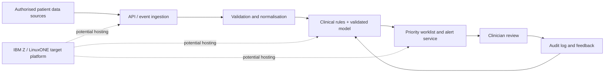

# CarePulse architecture (concept)

The current application is a local Streamlit prototype using synthetic records. The diagram shows a proposed target architecture, not an existing IBM deployment. Any clinical model, thresholds, or workflow must be validated and governed by qualified healthcare professionals before use.
